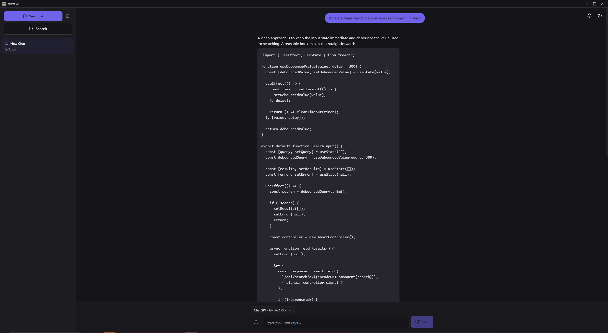
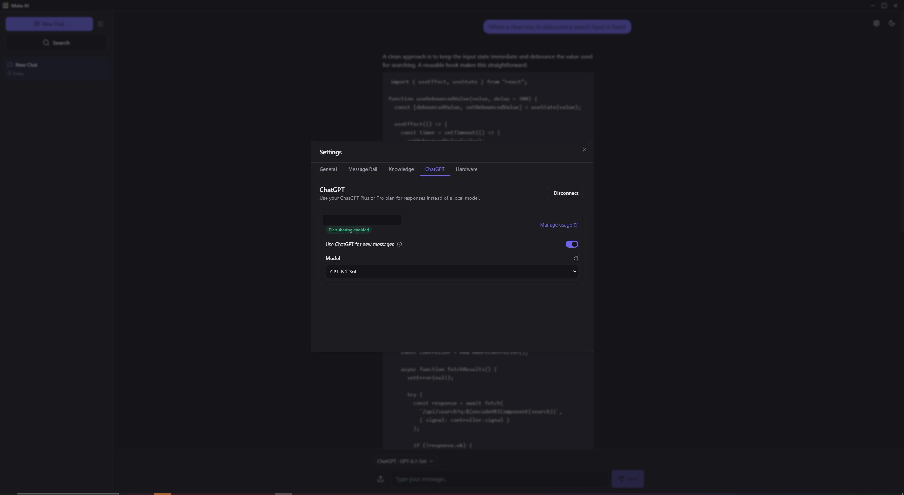
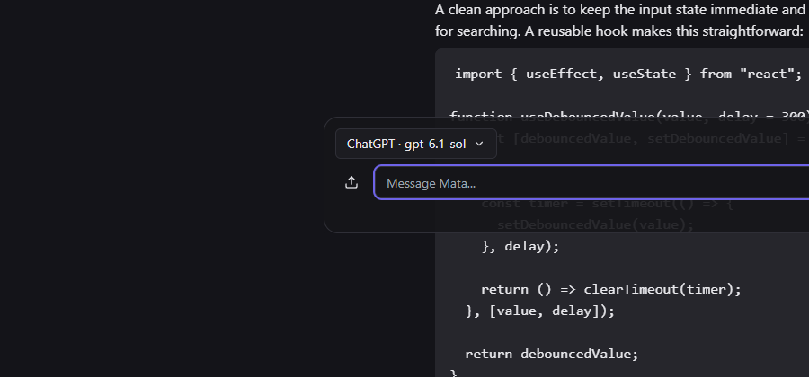

# Mata

Desktop chat app for Ollama, built mostly so I'd have a decent local UI for the models I run at home instead of using the terminal. It also supports Sign in with ChatGPT now, so if you've got a Plus or Pro subscription you can use that instead of paying for API credits separately. Chat history is just flat JSON on disk, so nothing leaves your machine unless you're actually talking to ChatGPT.



## Model routing

There are three modes you can switch between per message: `ollama`, `chatgpt`, or `auto`. Auto mode checks whether the Ollama model you picked is actually pulled and whether Ollama is actually running before trying to use it, and only falls back to ChatGPT if that check fails. Images never fall back though. The Sign in with ChatGPT API route can't accept attachments at all (found that out the hard way), so an attached image always stays local no matter what mode you're in.

The code for talking to each backend lives in its own package, [`mata-provider-core`](https://github.com/jacobkobr/mata-provider-core). I pulled it out of the main app so it wouldn't get tangled up with the React/Zustand state, it's just one `Provider` interface (`checkStatus`, `listModels`, `generate`) with an Ollama implementation and a ChatGPT one.

## Features

- Full Ollama model catalog instead of a handful of hardcoded ones. Pull, delete, manage models, vision models included.
- A message rail, a small minimap on the side of the chat for jumping around long conversations, with color coded bookmarks and keyboard shortcuts.
- Quick ask: hit Ctrl+Shift+Space from anywhere and a small always on top window pops up so you can ask something without switching over to the main app.
- Stop, regenerate, edit, copy, and delete on individual messages, chat search, a compact window mode, light and dark themes.





## Running it

```bash
git clone https://github.com/jacobkobr/mata.git
cd mata
npm install
npm run electron-dev
```

You'll need Ollama running locally, a ChatGPT account to sign into, or both. If you've got both set up, auto mode is what decides which one actually handles a given message.

## Building

```bash
npm run pack   # unpacked build, mostly for testing
npm run dist   # windows installer
```

I've only set up electron-builder for Windows so far since that's what I use day to day.

## Stack

Next.js 14, Electron, Zustand, Tailwind, and Radix for the UI. Sign in with ChatGPT uses OpenAI's own devkit, vendored in unmodified and kept under its own license since I didn't want to touch the vendor code directly.

## License

MIT, see LICENSE.
